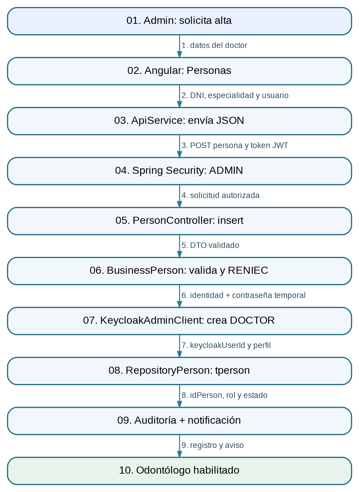

# 1. Alta y habilitación de odontólogo

**Responsable:** Gomez Coaquira Jeymi Johan

**Inicio:** El administrador necesita incorporar a un odontólogo con acceso al sistema.

**Resultado:** Odontólogo creado en Keycloak y registrado en tperson, con rol DOCTOR y cuenta habilitada.

## Diagrama de arquitectura E2E



## Recorrido de extremo a extremo

1. **Solicitud:** ADMIN abre Personas y completa la ficha de nuevo odontólogo. **Datos:** Formulario: DNI, teléfono, correo, especialidad, usuario y clave temporal.
2. **Formulario:** person-list.ts construye RequestPersonUpsert. **Datos:** role=DOCTOR; createAccessAccount=true.
3. **HTTP:** ApiService envía POST person/insert. **Datos:** JSON con datos sin información de otro paciente.
4. **Seguridad:** SecurityConfig requiere rol ADMIN para /person/**. **Datos:\*\* JWT y authorities de Keycloak.
5. **Controlador:** PersonController.actionInsert recibe @Valid RequestPersonInsert. **Datos:** DTO validado de persona.
6. **Negocio:** BusinessPerson.insert verifica formatos, duplicidad y consulta DNI. **Datos:** DNI y datos de RENIEC/Decolecta.
7. **Identidad:** KeycloakAdminClient.createUser crea la cuenta si procede. **Datos:** username, email, password temporal, rol DOCTOR.
8. **Persistencia:** BusinessPerson guarda EntityPerson mediante repositoryPerson.saveAndFlush. **Datos:** tperson: keycloakUserId, fullName, dni, role, active.
9. **Trazabilidad:** BusinessAuditLog y BusinessNotification registran el alta. **Datos:** evento REGISTRAR_PERSONA y notificación.
10. **Resultado:** Backend devuelve éxito y frontend refresca lista. **Datos:** Cuenta de odontólogo creada y registro verificable.

## Endpoints relevantes

- `GET /api/person/reniec/{dni}`
- `POST /api/person/insert`

## Tablas

`tperson`, `tauditlog`, `tnotification`

## Evidencia del código (extractos parciales)

Estos extractos provienen del código original; para revisar la implementación completa se requiere acceso al repositorio privado del grupo.

### Formulario de alta (Angular)

**Ruta de origen:** `frontend/src/app/page/person/person-list/person-list.ts` (líneas 270–297)

```ts
0270 |   protected save(): void {
0271 |     if (!this.validateBusinessRules()) {
0272 |       return;
0273 |     }
0274 |
0275 |     const raw = this.form.getRawValue();
0276 |     const payload: RequestPersonUpsert = {
0277 |       dni: raw.dni,
0278 |       phone: this.nullIfEmpty(raw.phone),
0279 |       email: this.nullIfEmpty(raw.email),
0280 |       birthDate: this.nullIfEmpty(raw.birthDate),
0281 |       gender: raw.gender,
0282 |       role: raw.role,
0283 |       userLogin: this.nullIfEmpty(normalizeUsername(raw.userLogin)),
0284 |       specialty: this.nullIfEmpty(raw.specialty),
0285 |       createAccessAccount: raw.role === 'ADMIN' || raw.role === 'DOCTOR',
0286 |       temporaryPassword: raw.role === 'ADMIN' || raw.role === 'DOCTOR'
0287 |         ? this.nullIfEmpty(raw.temporaryPassword)
0288 |         : null
0289 |     };
0290 |
0291 |     const request$ = this.selectedPerson
0292 |       ? this.apiService.put<ResponseGeneric>(
0293 |           `person/update/${this.selectedPerson.idPerson}`,
0294 |           this.toUpdatePayload(payload)
0295 |         )
0296 |       : this.apiService.post<ResponseGeneric>('person/insert', payload);
0297 |
```

### Entrada HTTP (Spring)

**Ruta de origen:** `backend/src/main/java/com/ceramic/apiceramic/controller/PersonController.java` (líneas 63–76)

```java
0063 |     @PostMapping(path = "insert")
0064 |     public ResponseEntity<ResponsePersonInsert> actionInsert(
0065 |         @Valid @RequestBody RequestPersonInsert request
0066 |     ) {
0067 |         try {
0068 |             return ResponseEntity.ok(businessPerson.insert(request));
0069 |         } catch (Exception exception) {
0070 |             LOGGER.error(LOG_ERROR_MESSAGE, exception);
0071 |             ResponsePersonInsert response = new ResponsePersonInsert();
0072 |             response.exception();
0073 |             response.listMessage.add("Ocurrió un error al registrar la persona.");
0074 |             return ResponseEntity.status(HttpStatus.INTERNAL_SERVER_ERROR).body(response);
0075 |         }
0076 |     }
```

### Auditoría y notificación

**Ruta de origen:** `backend/src/main/java/com/ceramic/apiceramic/business/BusinessPerson.java` (líneas 170–190)

```java
0170 |             Map<String, Object> personMap = toPersonMap(entity);
0171 |             businessAuditLog.register(
0172 |                 "PERSONAS",
0173 |                 "REGISTRAR_PERSONA",
0174 |                 "Person",
0175 |                 entity.getIdPerson(),
0176 |                 "Se registró una persona con rol " + entity.getRole() + ".",
0177 |                 null,
0178 |                 personMap
0179 |             );
0180 |             if (entity.getRole() == EnumPersonRole.DOCTOR) {
0181 |                 businessNotification.createForRole(
0182 |                     "ADMIN",
0183 |                     "Doctor registrado",
0184 |                     "Se registró el doctor " + entity.getFullName() + ".",
0185 |                     "PERSONAS",
0186 |                     entity.getIdPerson()
0187 |                 );
0188 |             }
0189 |             response.setPerson(personMap);
0190 |             response.success();
```

## Manejo de errores

- DNI incorrecto o fallos de Decolecta: se devuelve advertencia y no se crea la persona.
- Usuario o correo duplicados: se bloquea el alta.
- Si falla la persistencia después de crear la cuenta, se intenta eliminar el usuario de Keycloak; no es una transacción distribuida.

## Decisión técnica

Se observan Spring Security por rol, validación de entrada, consulta externa de DNI y coordinación Keycloak–MariaDB. Como alternativa teórica, centralizar identidades y datos clínicos en una sola base simplificaría el alta, pero perdería separación del proveedor de identidad.
