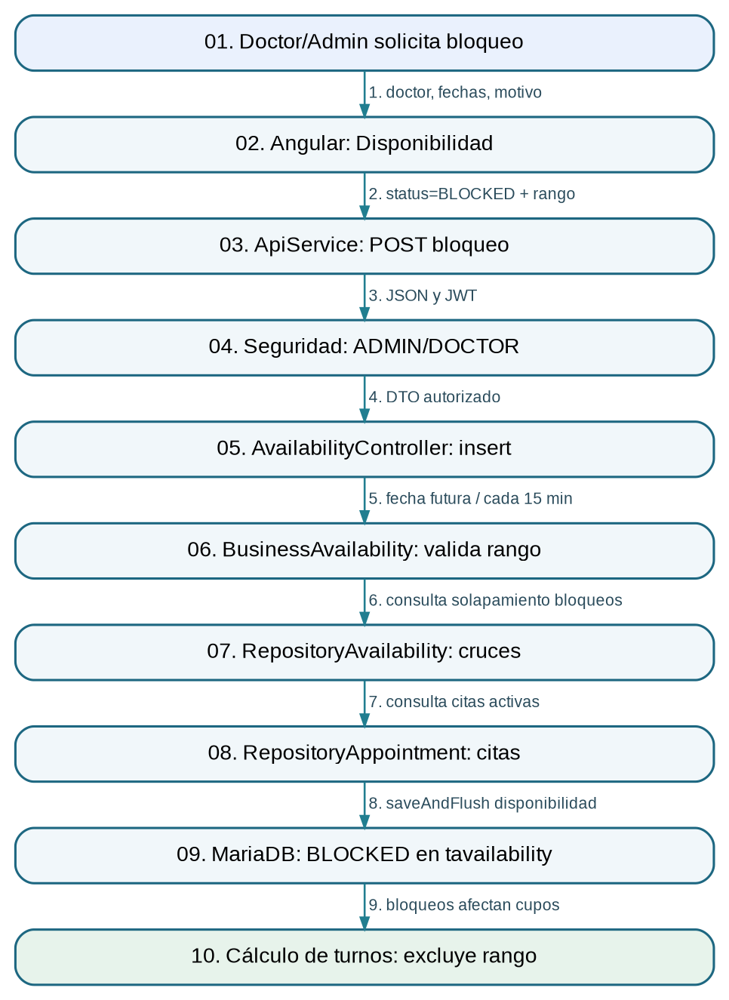

# 2. Bloqueo de agenda y exclusión de turnos

**Responsable:** Magallan Rojas Frank Antoni

**Inicio:** El doctor o administrador necesita impedir reservas durante un periodo de ausencia o descanso.

**Resultado:** Rango persistido como BLOCKED en tavailability y considerado al calcular turnos disponibles.

## Diagrama de arquitectura E2E


## Recorrido de extremo a extremo

1. **Evento:** Doctor necesita bloquear un horario futuro. **Datos:** Identidad del odontólogo y motivo.
2. **Pantalla:** availability-list.ts valida el formulario de bloqueo. **Datos:** idPersonDoctor, startDateTime, endDateTime, reason.
3. **Petición:** ApiService hace POST availability/insert. **Datos:** status BLOCKED en JSON.
4. **Permisos:** Spring Security exige ADMIN o DOCTOR; acceso del doctor queda acotado. **Datos:** Token JWT / usuario actual.
5. **Controller:** AvailabilityController.actionInsert delega al negocio. **Datos:** RequestAvailabilityInsert.
6. **Reglas:** BusinessAvailability exige fecha futura, intervalos de 15 min, máximo 24 h y motivo. **Datos:** Inicio/fin/motivo.
7. **Cruce bloqueos:** RepositoryAvailability comprueba que no se superponga otro bloqueo. **Datos:** idDoctor + rango.
8. **Cruce citas:** RepositoryAppointment comprueba citas CONFIRMED o IN_PROGRESS en el rango. **Datos:** Citas activas superpuestas.
9. **Persistencia:** BusinessAvailability guarda registro BLOCKED. **Datos:** tavailability.
10. **Resultado:** BusinessAppointment consulta bloqueos al calcular cupos. **Datos:** Turnos no disponibles para el doctor durante el rango.

## Endpoints relevantes

- `POST /api/availability/insert`
- `GET /api/appointment/public/available-slots`

## Tablas

`tavailability`, `tappointment`, `tperson`

## Evidencia del código (extractos parciales)

Estos extractos provienen del código original; para revisar la implementación completa se requiere acceso al repositorio privado del grupo.

### Formulario y llamada API

**Ruta de origen:** `frontend/src/app/page/availability/availability-list/availability-list.ts` (líneas 207–230)

```ts
0207 |   protected save(): void {
0208 |     if (!this.validateForm()) {
0209 |       return;
0210 |     }
0211 | 
0212 |     const raw = this.form.getRawValue();
0213 |     const payload = { ...raw, reason: normalizeText(raw.reason) || null } as AvailabilityPayload;
0214 |     const request$ = this.selectedAvailability
0215 |       ? this.apiService.put<ResponseGeneric>(`availability/update/${this.selectedAvailability.idAvailability}`, payload)
0216 |       : this.apiService.post<ResponseGeneric>('availability/insert', payload);
0217 | 
0218 |     this.saving = true;
0219 |     request$
0220 |       .pipe(finalize(() => (this.saving = false)))
0221 |       .subscribe({
0222 |         next: (response) => {
0223 |           if (response.type !== 'success') {
0224 |             this.showError(response.listMessage?.join(' ') || 'No se pudo guardar el bloqueo.');
0225 |             return;
0226 |           }
0227 | 
0228 |           this.dialogVisible = false;
0229 |           this.messageService.add({
0230 |             severity: 'success',
```

### Endpoint bloqueo

**Ruta de origen:** `backend/src/main/java/com/ceramic/apiceramic/controller/AvailabilityController.java` (líneas 48–60)

```java
0048 |     @PostMapping(path = "insert")
0049 |     public ResponseEntity<ResponseAvailabilityInsert> actionInsert(
0050 |         @Valid @RequestBody RequestAvailabilityInsert request
0051 |     ) {
0052 |         try {
0053 |             return ResponseEntity.ok(businessAvailability.insert(request));
0054 |         } catch (Exception exception) {
0055 |             LOGGER.error(LOG_ERROR_MESSAGE, exception);
0056 |             ResponseAvailabilityInsert response = new ResponseAvailabilityInsert();
0057 |             response.exception();
0058 |             response.listMessage.add("Ocurrió un error al registrar la disponibilidad.");
0059 |             return ResponseEntity.status(HttpStatus.INTERNAL_SERVER_ERROR).body(response);
0060 |         }
```

### Uso del bloqueo en turnos

**Ruta de origen:** `backend/src/main/java/com/ceramic/apiceramic/business/BusinessAppointment.java` (líneas 702–723)

```java
0702 |     private List<Map<String, Object>> buildClinicSlotList(LocalDateTime from, LocalDateTime to, int duration) {
0703 |         List<EntityPerson> doctors = repositoryPerson
0704 |             .findAllByRoleAndActiveTrueOrderByFullNameAsc(EnumPersonRole.DOCTOR);
0705 |         List<EntityAvailability> availability = repositoryAvailability
0706 |             .findBlockingBetween(from, to, DOCTOR_BLOCK_STATUS_LIST);
0707 |         List<EntityAppointment> appointments = repositoryAppointment
0708 |             .findBlockingBetween(from, to, BLOCKING_STATUS_LIST);
0709 |         return slotCalculator.calculateClinicSlots(doctors, availability, appointments, from, to, duration);
0710 |     }
0711 | 
0712 |     private List<Map<String, Object>> buildDoctorSlotList(
0713 |         EntityPerson doctor,
0714 |         LocalDateTime from,
0715 |         LocalDateTime to,
0716 |         int duration
0717 |     ) {
0718 |         List<EntityAvailability> availability = repositoryAvailability
0719 |             .findBlockingBetween(from, to, DOCTOR_BLOCK_STATUS_LIST);
0720 |         List<EntityAppointment> appointments = repositoryAppointment
0721 |             .findBlockingBetween(from, to, BLOCKING_STATUS_LIST);
0722 |         return slotCalculator.calculateDoctorSlots(doctor, availability, appointments, from, to, duration);
0723 |     }
```

## Manejo de errores

- No permite crear un bloqueo en un rango pasado, invertido o con intervalos que no sean de 15 minutos.
- Rechaza superposición con otro bloqueo del doctor.
- Rechaza bloquear horarios que ya contienen cita CONFIRMED o IN_PROGRESS.

## Decisión técnica

Los turnos libres se calculan a partir de citas y bloqueos, en lugar de persistir todos los intervalos libres. Alternativa hipotética: guardar cada turno libre como una fila, lo que añadiría sincronización y riesgo de estados obsoletos.

## Guion oral de repaso

1. Mi evento de negocio es la ausencia temporal del doctor.
2. En Angular capturo fecha/hora inicial, final y motivo, y llamo al endpoint availability/insert.
3. El backend valida el rango, la identidad del doctor y dos tipos de conflicto: bloqueos ya existentes y citas en curso o confirmadas.
4. Cuando no hay conflicto, guarda un BLOCKED en tavailability.
5. BusinessAppointment lee esos bloqueos al calcular horarios; el resultado medible es que ese intervalo deja de ofrecerse como disponible.
