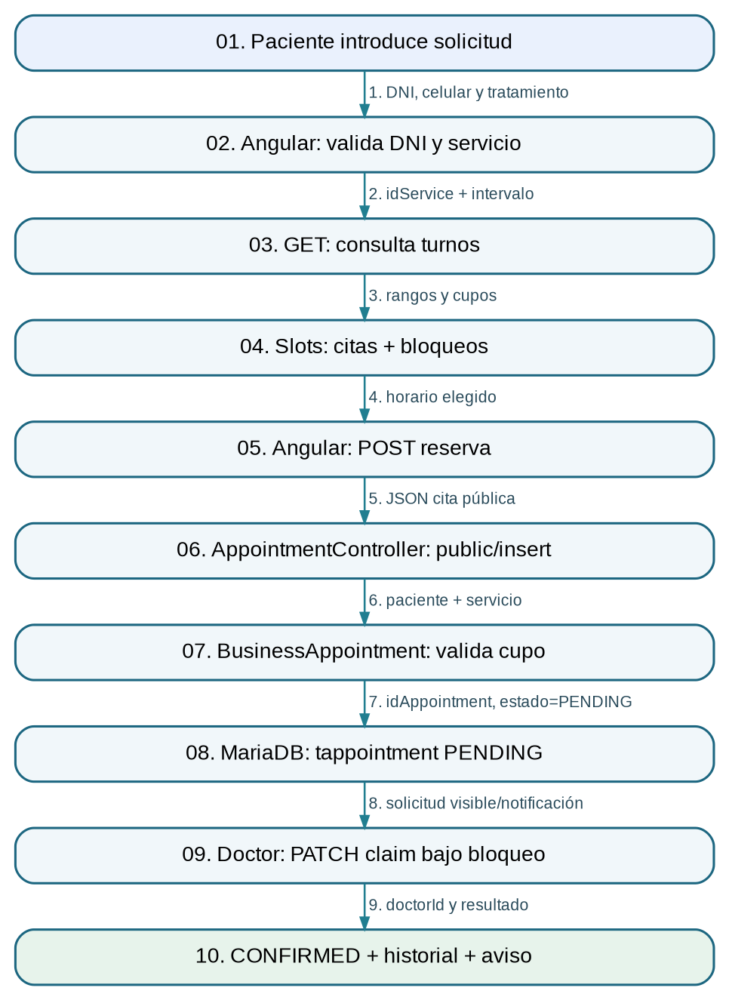

# 3. Reserva pública y confirmación de cita

**Responsable:** Rios Ccarapa Jhon Antony

**Inicio:** Un paciente solicita una cita odontológica desde la página pública.

**Resultado:** Cita registrada PENDING y luego CONFIRMED con un doctor asignado al aceptarla.

## Diagrama de arquitectura E2E


## Recorrido de extremo a extremo

1. **Evento:** Paciente llena DNI, teléfono, servicio y selecciona horario. **Datos:** Identidad y preferencia de atención.
2. **Consulta DNI:** Angular consulta /person/reniec/{dni} para autocompletar nombres. **Datos:** Respuesta RENIEC o advertencia.
3. **Disponibilidad:** Frontend pide appointment/public/available-slots. **Datos:** idService + from + to.
4. **Motor turnos:** BusinessAppointment calcula capacidad con citas y bloqueos. **Datos:** Rangos BLOCKED y citas activas.
5. **Solicitud HTTP:** Angular ejecuta POST appointment/public/insert. **Datos:** DNI, teléfono, servicio, fecha.
6. **Controller:** AppointmentController.actionInsertPublic valida el DTO. **Datos:** RequestAppointmentPublicInsert.
7. **Negocio:** BusinessAppointment.insertPublic busca/crea paciente y valida horario/capacidad. **Datos:** Patient + Service + intervalo.
8. **Persistencia:** Inserta tappointment PENDING sin doctor y emite notificaciones. **Datos:** idAppointment, status=PENDING.
9. **Aceptación:** Doctor autenticado llama PATCH appointment/claim/{id}. **Datos:** Token DOCTOR + idAppointment.
10. **Resultado:** claim bloquea la fila, valida disponibilidad, asigna doctor, CONFIRMED y asegura historial. **Datos:** Doctor asignado y confirmación registrada.

## Endpoints relevantes

- `GET /api/person/reniec/{dni}`
- `GET /api/appointment/public/available-slots`
- `POST /api/appointment/public/insert`
- `PATCH /api/appointment/claim/{idAppointment}`

## Tablas

`tperson`, `tservice`, `tappointment`, `tmedicalhistory`, `tnotification`, `tauditlog`

## Evidencia del código (extractos parciales)

Estos extractos provienen del código original; para revisar la implementación completa se requiere acceso al repositorio privado del grupo.

### Solicitud pública en Angular

**Ruta de origen:** `frontend/src/app/page/public/appointment-public/appointment-public.ts` (líneas 229–251)

```ts
0229 |   protected submit(): void {
0230 |     if (this.form.invalid || !this.reniec) {
0231 |       this.form.markAllAsTouched();
0232 |       this.messageService.add({ severity: 'warn', summary: 'Formulario incompleto', detail: 'Complete sus datos, valide el DNI y seleccione un horario.' });
0233 |       return;
0234 |     }
0235 | 
0236 |     const raw = this.form.getRawValue();
0237 |     const body = {
0238 |       dni: raw.dni,
0239 |       phone: raw.phone,
0240 |       email: null,
0241 |       birthDate: null,
0242 |       gender: 'NOT_SPECIFIED',
0243 |       idService: raw.idService,
0244 |       appointmentDateTime: this.normalizeDateTime(raw.appointmentDateTime),
0245 |       patientComment: raw.patientComment || null
0246 |     };
0247 | 
0248 |     this.saving = true;
0249 |     this.apiService.post<ResponseGeneric>('appointment/public/insert', body)
0250 |       .pipe(finalize(() => (this.saving = false)))
0251 |       .subscribe({
```

### Controller POST público

**Ruta de origen:** `backend/src/main/java/com/ceramic/apiceramic/controller/AppointmentController.java` (líneas 69–82)

```java
0069 |     @PostMapping(path = "public/insert")
0070 |     public ResponseEntity<ResponseAppointmentPublicInsert> actionInsertPublic(
0071 |         @Valid @RequestBody RequestAppointmentPublicInsert request
0072 |     ) {
0073 |         try {
0074 |             return ResponseEntity.ok(businessAppointment.insertPublic(request));
0075 |         } catch (Exception exception) {
0076 |             LOGGER.error(LOG_ERROR_MESSAGE, exception);
0077 |             ResponseAppointmentPublicInsert response = new ResponseAppointmentPublicInsert();
0078 |             response.exception();
0079 |             response.listMessage.add("Ocurrió un error al registrar la solicitud de cita.");
0080 |             return ResponseEntity.status(HttpStatus.INTERNAL_SERVER_ERROR).body(response);
0081 |         }
0082 |     }
```

### Bloqueo y asignación del doctor

**Ruta de origen:** `backend/src/main/java/com/ceramic/apiceramic/business/BusinessAppointment.java` (líneas 197–232)

```java
0197 |     public ResponseAppointmentStatus claim(String idAppointment) {
0198 |         ResponseAppointmentStatus response = new ResponseAppointmentStatus();
0199 |         Optional<EntityPerson> doctorOptional = accessControl.currentDoctor(response.listMessage);
0200 |         Optional<EntityAppointment> appointmentOptional = repositoryAppointment.findByIdForUpdate(normalizeId(idAppointment));
0201 |         if (doctorOptional.isEmpty() || appointmentOptional.isEmpty()) {
0202 |             if (appointmentOptional.isEmpty()) {
0203 |                 response.listMessage.add("No se encontró la solicitud de cita.");
0204 |             }
0205 |             response.warning();
0206 |             return response;
0207 |         }
0208 | 
0209 |         EntityAppointment entity = appointmentOptional.get();
0210 |         EntityPerson doctor = repositoryPerson.findByIdForUpdate(doctorOptional.get().getIdPerson())
0211 |             .orElse(doctorOptional.get());
0212 |         if (entity.getStatus() != EnumAppointmentStatus.PENDING || entity.getParentDoctor() != null) {
0213 |             response.warning();
0214 |             response.listMessage.add("La cita ya fue tomada por otro doctor o dejó de estar pendiente.");
0215 |             return response;
0216 |         }
0217 |         if (!Boolean.TRUE.equals(doctor.getActive())) {
0218 |             response.warning();
0219 |             response.listMessage.add("El doctor se encuentra inactivo.");
0220 |             return response;
0221 |         }
0222 |         LocalDateTime start = entity.getAppointmentDateTime();
0223 |         LocalDateTime end = calculateEndDateTime(entity);
0224 |         if (start.isBefore(LocalDateTime.now())) {
0225 |             response.warning();
0226 |             response.listMessage.add("No se puede confirmar una solicitud cuyo horario ya pasó.");
0227 |             return response;
0228 |         }
0229 |         if (!isDoctorFree(doctor, start, end, entity.getIdAppointment(), response.listMessage)) {
0230 |             response.warning();
0231 |             return response;
0232 |         }
```

## Manejo de errores

- Formulario incompleto, DNI no validado o teléfono inadecuado: no registra cita.
- Horario/capacidad no disponibles: el backend devuelve advertencia.
- Dos doctores intentan tomar la misma cita: findByIdForUpdate y validación PENDING permiten solo una asignación válida.

## Decisión técnica

La asignación se difiere hasta que un doctor toma la solicitud. La fila de la cita se bloquea dentro de una transacción; alternativa hipotética: asignar automáticamente un doctor al solicitar, lo que exigiría otra política de reparto.

## Guion oral de repaso

1. El paciente inicia el proceso con su DNI, servicio y horario.
2. Angular obtiene los cupos del backend, donde se cruzan las citas y los bloqueos.
3. Al confirmar la solicitud se inserta una cita PENDING, todavía sin doctor, y se notifican los participantes.
4. Un doctor entra al panel y ejecuta claim sobre la solicitud pendiente; la fila se bloquea para evitar que dos doctores la tomen.
5. El resultado es CONFIRMED, con doctor asignado e historial programado.
