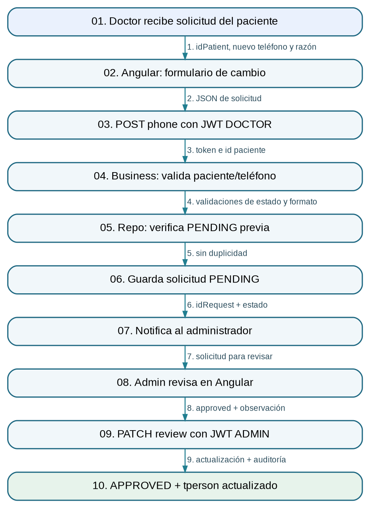

# 5. Solicitud y aprobación de cambio de teléfono

**Responsable:** Paniagua Ferrel Jhosep Emilio

**Inicio:** Un paciente necesita cambiar el número registrado y el odontólogo solicita aprobación administrativa.

**Resultado:** Solicitud APPROVED y teléfono actualizado en tperson, con auditoría y aviso al doctor.

## Diagrama de arquitectura E2E


## Recorrido de extremo a extremo

1. **Evento:** Paciente solicita corregir teléfono ante un doctor. **Datos:** id paciente, nuevo número, motivo.
2. **Formulario:** patient-data-change-list.ts valida solicitud. **Datos:** idPersonPatient, requestedPhone, reason.
3. **Seguridad:** POST phone requiere rol DOCTOR y JWT. **Datos:** Usuario autenticado.
4. **Negocio:** BusinessPatientDataChangeRequest valida existencia, rol PATIENT y teléfono peruano. **Datos:** idPerson, valor nuevo.
5. **Unicidad:** Repository comprueba ausencia de solicitud PHONE PENDING para el mismo paciente. **Datos:** Identificador del paciente.
6. **Persistencia 1:** Inserta tpatientdatachangerequest en PENDING sin cambiar aún tperson. **Datos:** Valor anterior, nuevo y motivo.
7. **Alerta:** Auditoría y notificación avisan al ADMIN. **Datos:** idRequest y autor.
8. **Revisión:** Administrador abre la lista y decide aprobar/rechazar. **Datos:** idRequest, approved, observation.
9. **Seguridad de revisión:** PATCH review requiere rol ADMIN; backend bloquea solicitud y verifica estado. **Datos:** JWT ADMIN, decisión.
10. **Resultado:** Al aprobar, actualiza teléfono en tperson, marca APPROVED, registra auditoría y notifica al doctor. **Datos:** Número actualizado y trazabilidad.

## Endpoints relevantes

- `POST /api/patient-data-change/phone`
- `GET /api/patient-data-change/getall`
- `PATCH /api/patient-data-change/review/{idRequest}`

## Tablas

`tpatientdatachangerequest`, `tperson`, `tauditlog`, `tnotification`

## Evidencia del código (extractos parciales)

Estos extractos provienen del código original; para revisar la implementación completa se requiere acceso al repositorio privado del grupo.

### Solicitud desde Angular

**Ruta de origen:** `frontend/src/app/page/patient-data-change/patient-data-change-list/patient-data-change-list.ts` (líneas 165–189)

```ts
0165 |   protected createRequest(): void {
0166 |     if (this.createForm.invalid) {
0167 |       this.createForm.markAllAsTouched();
0168 |       this.showError('Complete correctamente los datos de la solicitud.');
0169 |       return;
0170 |     }
0171 | 
0172 |     this.saving = true;
0173 |     this.apiService
0174 |       .post<ResponseGeneric>('patient-data-change/phone', { ...this.createForm.getRawValue(), reason: normalizeText(this.createForm.controls.reason.value) })
0175 |       .pipe(finalize(() => (this.saving = false)))
0176 |       .subscribe({
0177 |         next: (response) => {
0178 |           if (response.type !== 'success') {
0179 |             this.showError(response.listMessage?.join(' ') || 'No se pudo registrar la solicitud.');
0180 |             return;
0181 |           }
0182 |           this.createDialogVisible = false;
0183 |           this.messageService.add({
0184 |             severity: 'success',
0185 |             summary: 'Solicitud enviada',
0186 |             detail: 'El administrador podrá revisar el cambio de teléfono.'
0187 |           });
0188 |           this.loadRequests();
0189 |         },
```

### Controlador y roles

**Ruta de origen:** `backend/src/main/java/com/ceramic/apiceramic/controller/PatientDataChangeRequestController.java` (líneas 38–52)

```java
0038 |     @PostMapping(path = "phone")
0039 |     @PreAuthorize("hasRole('DOCTOR')")
0040 |     public ResponseEntity<ResponsePatientDataChangeAction> createPhoneRequest(
0041 |         @AuthenticationPrincipal Jwt jwt,
0042 |         @Valid @RequestBody RequestPatientPhoneChangeInsert request
0043 |     ) {
0044 |         try {
0045 |             return ResponseEntity.ok(business.createPhoneRequest(jwt.getSubject(), request));
0046 |         } catch (Exception exception) {
0047 |             LOGGER.error("Error registrando solicitud de cambio de teléfono.", exception);
0048 |             ResponsePatientDataChangeAction response = new ResponsePatientDataChangeAction();
0049 |             response.exception();
0050 |             response.listMessage.add("Ocurrió un error al registrar la solicitud.");
0051 |             return ResponseEntity.status(HttpStatus.INTERNAL_SERVER_ERROR).body(response);
0052 |         }
```

### Decisión y cambio real

**Ruta de origen:** `backend/src/main/java/com/ceramic/apiceramic/business/BusinessPatientDataChangeRequest.java` (líneas 161–196)

```java
0161 |     public ResponsePatientDataChangeAction review(
0162 |         String idRequest,
0163 |         String keycloakUserId,
0164 |         String username,
0165 |         RequestPatientDataChangeReview request
0166 |     ) {
0167 |         ResponsePatientDataChangeAction response = new ResponsePatientDataChangeAction();
0168 |         Optional<EntityPerson> adminOptional = repositoryPerson.findByKeycloakUserId(keycloakUserId);
0169 |         if (adminOptional.isEmpty() || adminOptional.get().getRole() != EnumPersonRole.ADMIN
0170 |             || !Boolean.TRUE.equals(adminOptional.get().getActive())) {
0171 |             response.warning();
0172 |             response.listMessage.add("La cuenta administrativa no está vinculada, está inactiva o no tiene rol ADMIN.");
0173 |             return response;
0174 |         }
0175 | 
0176 |         Optional<EntityPatientDataChangeRequest> entityOptional = repositoryRequest.findByIdForUpdate(normalize(idRequest));
0177 |         if (entityOptional.isEmpty()) {
0178 |             response.warning();
0179 |             response.listMessage.add("No se encontró la solicitud que se desea revisar.");
0180 |             return response;
0181 |         }
0182 | 
0183 |         EntityPatientDataChangeRequest entity = entityOptional.get();
0184 |         if (entity.getStatus() != EnumPatientDataChangeRequestStatus.PENDING) {
0185 |             response.warning();
0186 |             response.listMessage.add("La solicitud ya fue revisada anteriormente.");
0187 |             return response;
0188 |         }
0189 | 
0190 |         if (!Boolean.TRUE.equals(request.getApproved())
0191 |             && !StringUtils.hasText(request.getObservation())) {
0192 |             response.warning();
0193 |             response.listMessage.add("La observación es obligatoria cuando se rechaza una solicitud.");
0194 |             return response;
0195 |         }
0196 | 
```

## Manejo de errores

- No se admite un teléfono que no empiece por 9 o no tenga nueve dígitos.
- Se rechaza otra solicitud PHONE mientras haya una PENDING para el paciente.
- ADMIN no vinculado, solicitud ya revisada o rechazo sin observación: se devuelve advertencia.

## Decisión técnica

La modificación requiere dos roles y una aprobación explícita; alternativa hipotética: que el doctor edite directamente tperson, más simple pero sin segregación de funciones.
